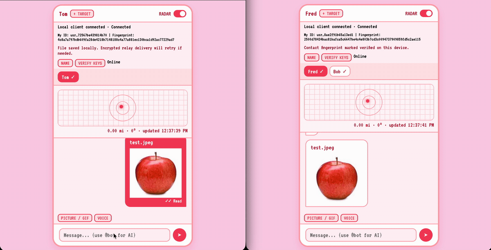
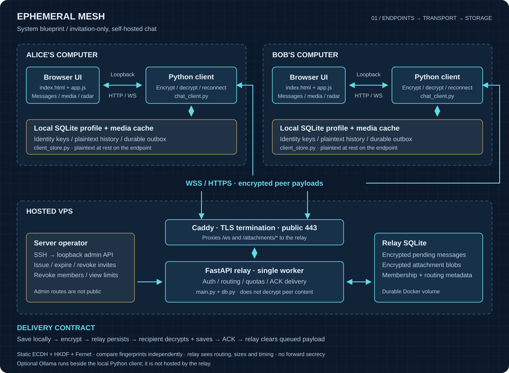

# Ephemeral Mesh

An invitation-only, self-hosted encrypted chat project built with Python, FastAPI, WebSockets, SQLite, and a browser UI. A server operator manages membership; friends run a small local Python client that encrypts messages and serves their private UI on loopback.

**Status:** initial portfolio release for small trusted groups. The maintainer reports successful VPS acceptance testing; reproducible automated checks are described below. This is a portfolio project with automated regression tests, not an independently audited secure messenger. Despite the name, local history persists and pending relay messages do not automatically disappear.

## Demo

<!-- Optimized, silent GIF; the original recording stays local and is not committed. -->


*25-second demo. GIFs are silent; the recording shows voice-note capture, delivery and playback controls.*

## Features

- Single-use, expiring invitations; administrator revocation; persistent identities and authenticated reconnects.
- Durable encrypted offline delivery, recipient acknowledgments, deduplication, retryable outboxes, and delivered/read states.
- Encrypted pictures/GIFs and voice notes, with 5 MiB raw-file limits and relay storage quotas.
- Local aliases, fingerprint verification, presence, typing, and explicit temporary location sharing.
- Interrupted-registration recovery and password-encrypted profile backups.
- Non-root Docker relay, Caddy HTTPS configuration, health checks, CI, and operator documentation.

## Start here

On macOS/Linux with Python 3.14:

```sh
python3.14 -m venv venv
./venv/bin/python -m pip install -r requirements.txt
```

- **Test locally:** follow [TESTING.md](TESTING.md) to launch a relay and two profiles.
- **Host a server:** follow [DEPLOYMENT.md](DEPLOYMENT.md) for Docker, DNS, HTTPS, invitations, backup, and restart checks.
- **Join a friend:** obtain the project from a trusted source, then run `./venv/bin/python chat_client.py --profile me --invite` and paste their entire invitation link at the hidden prompt. Open the loopback URL printed by the client. Later launches need only `--profile me`.
- **Recover a profile:** see [RECOVERY.md](RECOVERY.md).
- **Manage membership:** see [ADMIN_API.md](ADMIN_API.md).
- **Automate admin checks on your VPS:** see [ADMIN_TESTING.md](ADMIN_TESTING.md).
- **Deploy to a Debian 12 / Hostinger VPS:** see [HOSTINGER_SETUP.md](HOSTINGER_SETUP.md).

Both people exchange their displayed user IDs to add contacts, then independently compare fingerprints. An invite grants server membership; it does not verify a person's identity. Windows is not currently supported by the profile-locking implementation.

## Architecture

<!-- Editable SVG documents endpoint, transport, storage and administrator boundaries. -->


[Open the full-size blueprint](docs/assets/architecture.svg).

`main.py` routes authenticated sessions. `db.py` implements transactional membership, delivery queues and attachment storage. `chat_client.py` owns encryption, transport and the local browser bridge. `client_store.py` owns persistent keys/history/outbox. `index.html` and `app.js` display state and capture user actions; encryption is performed by Python, not JavaScript. `bc.py` is a compatibility launcher.

Delivery is at least once across the network. Stable IDs and a local transaction give one visible history item per sender/message ID. The client commits received content, deduplication state and an outgoing receipt before acknowledging the relay. Attachments use a fresh file key delivered inside the encrypted chat envelope; upload retries reuse the exact ciphertext and ID.

The relay is deliberately one process/worker. In-memory connection routing is coordinated with SQLite transactions; it is not a horizontally scaled distributed service. Tests exercise concurrent registration/quota races, reconnects, restart durability, a 120-message backlog, authentication boundaries and malicious inputs. That backlog is a regression test, not a throughput benchmark.

## Security boundaries

See [SECURITY.md](SECURITY.md) before using real personal data. The relay sees member identities, public keys, routing, sizes and timing. Local history/keys/media are plaintext at rest; exported backups are password-encrypted. Static ECDH does not provide forward secrecy, a ratchet, or multi-device key rotation. No external audit or production capacity certification is claimed. The [release checks](RELEASE_CHECKS.md) distinguish automated results from maintainer-reported deployment tests.

## Regression checks

```sh
./venv/bin/python -m unittest discover -s tests -v
node --check app.js
node --test tests/test_ui.cjs
docker build -t ephemeral-mesh:local-test .
./venv/bin/python tests/docker_smoke.py
```

The Docker smoke test creates and removes only its own randomly named containers, network and volume. GitHub Actions runs the publication guard, Python/UI tests, Docker build/proxy smoke test, and Python dependency advisory scan. Do not commit `.mesh/`, `.env`, databases or backup files.

## Optional local AI helper

Run Ollama on the same computer as the Python client and pull `llama3.2:1b`. Sending `@bot Your question` in a selected conversation generates a local answer prefixed with `🤖 BOT:`. Both the prompt and answer are shared with that contact through the encrypted message path. The model receives only the current prompt, not conversation history or attachments. Ollama is optional; ordinary chat does not require it, and the relay does not run the model.

## Contributing

See [CONTRIBUTING.md](CONTRIBUTING.md) for setup, validation and changes that require security review. Keep test accounts, credentials, database files and packet captures out of pull requests. Use [SECURITY.md](SECURITY.md) for vulnerability-reporting guidance.

## License

Released under the [MIT License](LICENSE). See [PUBLISHING.md](PUBLISHING.md) for the first GitHub push checklist.
